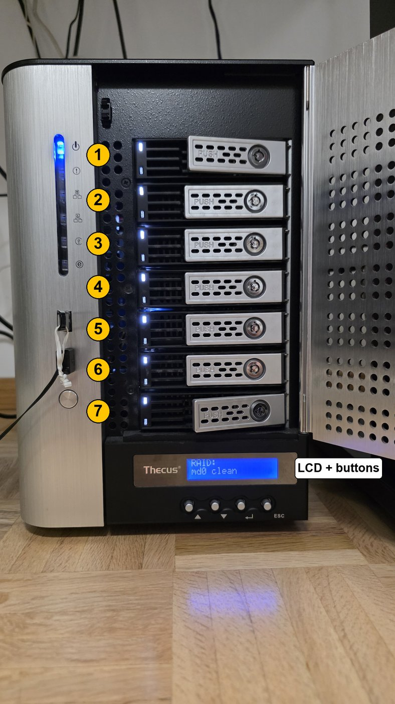

# Thecus N7510 hardware reference

Everything below was confirmed on a live N7510 by switching one pin or output
at a time and watching the front panel, unless marked otherwise.

## Platform

| Item | Value |
|---|---|
| Board | Intel "Granite Well" (Milstead platform), Phoenix BIOS `CDV_T30 X64` |
| CPU | Intel Atom D2701, 2.13 GHz, 2 cores / 4 threads |
| Chipset | ICH10R: LPC `8086:3a16`, SMBus `8086:3a30` (i801), AHCI `8086:3a22` at `0000:00:1f.2` |
| Network | 2× Intel 82574L (`enp1s0` = WAN/LAN1, `enp2s0` = LAN2 with systemd naming) |
| Extra SATA | 2× SiI3132: `0000:04:00.0` serves trays 6–7, `0000:05:00.0` the rear eSATA port |
| USB 3 | Renesas uPD720202 |
| Sensors / fans | ITE IT8728F at ISA `0x290` (`it87`) |
| Front panel MCU | ATmega168 on `/dev/ttyS0`, 9600 8N1, firmware `01.04.00` |
| LED drivers | 2× NXP PCA9532 on the i801 SMBus at `0x62` and `0x64` |
| Boot media | internal 1 GB DOM (UDinfo MDS) on AHCI port 0 holds Thecus OS |
| Board ID | `0x62` pins 0–3 read 6 (the N5550 reads 2) |

## Fans (IT8728F)

The BIOS leaves the PWM outputs in a state the mainline driver refuses
("Detected broken BIOS defaults, disabling PWM interface"). Load `it87` with
`fix_pwm_polarity=1`; Thecus's own `setfan.sh` sets the same active-high
polarity (register `0x14 = 0x80`) and runs the fans at full duty.

| PWM | Tachometer | Notes |
|---|---|---|
| `pwm1` | `fan1` | ~2500 RPM at 255, ~1000 RPM at 100 |
| `pwm2` | — | not connected |
| `pwm3` | `fan3` | ~2500 RPM at 255, ~1000 RPM at 100 |

Disk temperatures come from the mainline `drivetemp` driver. The DOM runs
warm (~40 °C) and is excluded from the fan curve.

## Trays

With the unit standing upright, trays are numbered 1–7 from the top; tray 7
is the bottom one, just above the LCD. Each tray has two LEDs at its left end:
an upper white one (hardware) and a lower two-colour one.

| Tray | Port | Red LED | Green LED |
|---|---|---|---|
| 1 | AHCI port 1 | `0x64` output 0 | ICH10 GPIO 0 |
| 2 | AHCI port 2 | `0x64` output 1 | ICH10 GPIO 2 |
| 3 | AHCI port 3 | `0x64` output 2 | ICH10 GPIO 3 |
| 4 | AHCI port 4 | `0x64` output 3 | ICH10 GPIO 4 |
| 5 | AHCI port 5 | `0x64` output 4 | ICH10 GPIO 5 |
| 6 | SiI3132 `04:00.0` port 0 | `0x64` output 5 | SiI3132, in hardware |
| 7 | SiI3132 `04:00.0` port 1 | `0x64` output 6 | SiI3132, in hardware |

- The ICH10 GPIO pins are active-low (low = on). GPIO 2–5 are in native mode
  at boot and must be switched to GPIO output.
- `0x64` outputs 7–15 have no visible function.
- The green LEDs of trays 1–5 only work in software: Thecus patched libata to
  toggle them on each command; `n7510-leds` samples `/sys/block/*/stat`
  instead.

## PCA9532 `0x62`

| Pin | Function |
|---|---|
| 0–3 | board-ID inputs; never drive |
| 4–6 | no visible function |
| **7** | **hard reset of the whole board; never drive** |
| 8 | no visible function |
| 9 | System "!" LED, orange |
| 10 | USB LED, blue |
| 11 | no visible function |
| 12 | System "!" LED, red |
| 13–15 | no visible function (15 resets the LCD MCU on the N5550; no visible effect here) |

PCA9532 LED selector registers: `LS0`–`LS3` at `0x06`–`0x09`, two bits per pin
(`01` = output on, i.e. pulled low). On the i801 bus only SMBus byte-data
writes work, not raw I²C writes.

## Other

| Item | Finding |
|---|---|
| Buzzer | the standard PC speaker (`pcspkr` input device, `EV_SND`/`SND_TONE`) |
| Power, LAN1, LAN2, upper tray LEDs | hardware-driven |
| eSATA LED | not driven by any `0x62` pin or by ICH10 GPIO 9, 27, 28, 34 or 49; most likely lit by the second SiI3132 while a device is attached, as the manual describes (unconfirmed) |
| Buttons | handled inside the LCD MCU, see [LCD protocol](lcd-protocol.md) |
| ICH10 GPIO 9, 27, 28, 34, 49 | configured by Thecus/the BIOS, no visible function found; leave as is |

## Power off

`poweroff` halts the system but leaves the board powered: the kernel prints
`reboot: Power down` after ACPI errors from `\_PTS` (`Could not resolve
symbol [\_SB.PCI0.LPCB.TPM.PTS], AE_NOT_FOUND`).

| Register (ICH10, PM base `0x400` from the FADT) | Value |
|---|---|
| `\_S5_` sleep type (DSDT) | SLP_TYPa = 7 (standard) |
| PM1a_CNT | `0x404` |
| SMI_EN (`PM base + 0x30`) | `0x33`: GBL_SMI_EN = 1, **SLP_SMI_EN = 1** |

With SLP_SMI_EN set, the chipset hands the S5 write to the BIOS's SMM
handler, which fails, so the power is never cut. Thecus OS simply calls
`/sbin/poweroff` (its old 3.10 kernel presumably got past `\_PTS`).
`src/n7510-poweroff`, a systemd `system-shutdown` hook, clears SLP_SMI_EN
right before power-off; the kernel's own sequence (flushing disk caches, then
S5) then switches the board off. Verified on the N7510; reboot and halt are
not affected. `tools/acpi-s5-info.py` shows these values read-only.

## openmediavault notes

- folder2ram mounts `/var/log` after journald starts, so the journal silently
  stops after boot; `systemd/folder2ram-journald.conf` restarts journald.
- Containers (for example Plex) can keep an md array mounted in their own
  mount namespace; stop them before stopping or reassembling an array.
